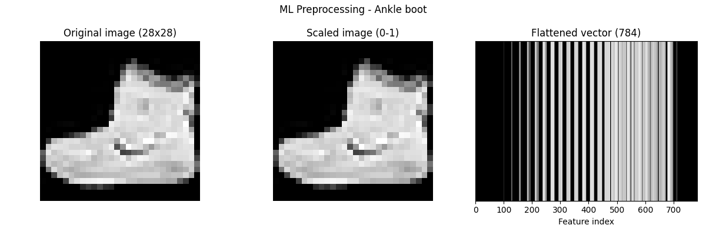

# 3.2 – Közös ML-előfeldolgozás

## 1. Feladat adatai

| Megnevezés | Érték |
|---|---|
| Felelős | Anna |
| Feature branch | `feature/03-02-ml-preprocessing` |
| Dátum | 2026.11.25. |

## 2. Feladat célja

A feladat célja a Logistic Regression, Random Forest és SVM 
modellek számára egységes, újrafelhasználható előfeldolgozási 
pipeline kialakítása. A baseline előfeldolgozás mellett opcionális 
jellemzőkinyerési, standardizálási és dimenziócsökkentési lehetőségek 
implementálása, amelyek a későbbi optimalizálási kísérletek során 
használhatók. További cél az ML és DL pipeline-ok baseline 
adatreprezentációjának konzisztenciája, valamint a data leakage elkerülése.

## 3. Elméleti háttér és alkalmazott módszerek

### Flattening és pixel scaling

A hagyományos ML-modellek bemenetként kétdimenziós 
jellemzőmátrixot várnak, amiben minden sor egy megfigyelést, 
minden oszlop pedig egy jellemzőt reprezentál.

Ennek megfelelően a 28×28 pixeles képeket 784 elemű 
jellemzővektorokká alakítjuk. A pixelértékeket float32 
adattípusra konvertáljuk, majd 255-tel történő osztással 
a 0–1 tartományba skálázzuk.

A művelet nem változtatja meg a képek információtartalmát, 
csupán azok numerikus reprezentációját. A képek kétdimenziós 
térbeli struktúrája azonban már nem jelenik meg explicit 
módon a modell bemenetében.

### StandardScaler

Opcionális transzformáció, amely jellemzőnként standardizálja 
az adatokat a training halmazon számított átlag és szórás alapján.
Elsősorban az SVM és Logistic Regression modellek esetében 
lehet hasznos. A Random Forest modell általában nem igényel 
standardizálást.

### Principal Component Analysis (PCA)

Lineáris dimenziócsökkentési módszer, amely az eredeti 
jellemzőket kisebb dimenziójú térbe transzformálja, 
a lehető legtöbb variancia megőrzésére törekedve.
Alkalmazásának célja a redundáns információk csökkentése, 
valamint a modellek tanítási idejének és számítási igényének 
potenciális mérséklése.
A megtartott komponensek száma konfigurálható.

### Histogram of Oriented Gradients (HOG)

Hagyományos képi jellemzőkinyerési módszer, amely a képek 
lokális intenzitásváltozásainak irányait reprezentálja.
A nyers pixelértékek helyett a képen található éleket, 
körvonalakat és lokális struktúrákat használja 
a jellemzővektor előállításához.
A HOG a flattening alternatívájaként alkalmazható.

Kiinduló konfiguráció:

| Paraméter | Érték |
|---|---|
| orientations | 9 |
| pixels_per_cell | (4, 4) |
| cells_per_block | (2, 2) |
| block_norm | L2-Hys |
| Kimeneti jellemzők száma | 1296 |

A konfiguráció később módosítható az optimalizálási 
kísérletek során.

## 4. Bemeneti adatok és előfeltételek

A preprocessing pipeline a közös `load_dataset()` függvény 
által biztosított nyers, egycsatornás PIL-képeket és egész 
osztálycímkéket tartalmazó adathalmazokat használja.
A training és validation indexek a hivatalos tanítóhalmaz 
eredeti sorrendjére hivatkoznak, és a közös 
adatfelosztásból érkeznek.
A teszthalmaz a teljes hivatalos Fashion-MNIST 
teszthalmazt tartalmazza.
A közös split integrációját követően az elvárt baseline 
kimeneti dimenziók:

| Adathalmaz | Feature matrix (X) | Címkevektor (y) |
|---|---|---|
| Training | (50000, 784) | (50000,) |
| Validation | (10000, 784) | (10000,) |
| Test | (10000, 784) | (10000,) |

A baseline jellemzőmátrixok float32, a címkevektorok 
int64 adattípusú NumPy tömbök.

### Felhasznált könyvtárak

| Könyvtár | Verzió | Funkció |
|---|---|---|
| NumPy | 2.2.6 | Tömbkezelés, flattening és pixel scaling |
| Scikit-learn | 1.6.1 | Pipeline, StandardScaler és PCA |
| Scikit-image | 0.25.2 | HOG feature extraction |
| Matplotlib | 3.10.3 | Vizualizáció |
| Unittest | Python standard library | Automatizált tesztelés |

## 5. Implementáció

### 5.1. Megvalósítási lépések

1. A közös adatbetöltő modul újrafelhasználása.
2. A training és validation indexek validálása.
3. A nyers képek és címkék kinyerése.
4. A képek float32 adattípusra konvertálása és skálázása.
5. A képek kilapítása vagy opcionális HOG feature extraction.
6. Opcionális StandardScaler és PCA transzformációk alkalmazása.
7. A training, validation és test jellemzőmátrixok, valamint 
   címkevektorok előállítása.
8. Automatizált unit tesztek implementálása.
9. A tényleges Fashion-MNIST adatokon történő vizuális ellenőrzés.

### Pipeline felépítése

A transzformációkat egy scikit-learn Pipeline objektum kezeli.

A pipeline végrehajtási sorrendje:

1. Pixel scaling
2. Flattening vagy HOG
3. StandardScaler (opcionális)
4. PCA (opcionális)

A `build_preprocessor()` függvény létrehozza a konfigurálható 
előfeldolgozási pipeline-t.

A `build_ml_datasets()` függvény végrehajtja az előfeldolgozást, 
és visszaadja a három feldolgozott adathalmazt, valamint 
az illesztett preprocessing pipeline-t.

Az illesztett pipeline később a betanított modellel együtt 
elmenthető és inferencia során újrafelhasználható.

### Data leakage megelőzése

A paramétertanulást igénylő transzformációk kizárólag 
a training halmazon kerülnek illesztésre.

```python
X_train = preprocessor.fit_transform(X_train)
X_val = preprocessor.transform(X_val)
X_test = preprocessor.transform(X_test)
```

A validation és test adatokra a training során meghatározott 
paramétereket alkalmazzuk.

A pipeline ellenőrzi továbbá:

- Az indexek érvényességét.
- A duplikált indexeket.
- A training és validation indexek közötti átfedést.
- A nyers képek dimenzióját és adattípusát.

### 5.2. Technikai döntések

| Döntés | Indoklás | Alternatív megoldás |
|---|---|---|
| Közös ML preprocessing modul | Egységes adatreprezentáció és kódduplikáció elkerülése | Modellenként külön preprocessing |
| NumPy float32 tömbök | Hatékony memóriahasználat | Float64 reprezentáció |
| Scikit-learn Pipeline | Moduláris, konfigurálható és újrafelhasználható transzformációk | Manuális transzformációs lépések |
| Training-only fit | Data leakage megelőzése | Teljes adathalmazon történő illesztés, amely leakage-et okozhat |
| Opcionális StandardScaler, PCA és HOG | Kontrollált optimalizálási kísérletek támogatása | Kizárólag nyers pixelértékek |
| Illesztett pipeline visszaadása | Reprodukálhatóság és későbbi inferencia | Pipeline újraillesztése |
| Unittest | Gyors ellenőrzés adatletöltés nélkül | Kizárólag manuális tesztelés |

### 5.3. Létrehozott vagy módosított fájlok

| Fájl | Funkció |
|---|---|
| `src/preprocessing/ml.py` | Közös ML preprocessing pipeline |
| `tests/test_ml_preprocessing.py` | Automatizált unit tesztek |
| `scripts/preview_ml_preprocessing.py` | Manuális és vizuális ellenőrzés |
| `results/figures/ml_preprocessing_example.png` | Baseline preprocessing vizualizációja |
| `requirements.txt` | Új könyvtárak és verziók hozzáadása |
| `docs/features/03_02_ml_preprocessing.md` | Feature branch dokumentációja |

### 5.4. Futtatási útmutató

Függőségek telepítése:

```bash
python -m pip install -r requirements.txt
```

Baseline preprocessing használata a közös split 
integrációját követően:

```python
from src.preprocessing.dataset import load_dataset
from src.preprocessing.ml import build_ml_datasets

ML_SETTINGS = {
    "standardize": False,
    "pca_components": None,
    "use_hog": False,
    "seed": 42,
}

train_dataset, test_dataset = load_dataset()

datasets, preprocessor = build_ml_datasets(
    train_dataset,
    test_dataset,
    train_indices,
    val_indices,
    **ML_SETTINGS,
)

X_train, y_train = datasets["train"]
X_val, y_val = datasets["val"]
X_test, y_test = datasets["test"]
```

A `train_indices` és `val_indices` változók a 3.4-es 
közös adatfelosztásból érkeznek.

### Opcionális konfigurációk

| Konfiguráció | StandardScaler | PCA | HOG | Feature-szám |
|---|---|---|---|---|
| Baseline | False | None | False | 784 |
| StandardScaler | True | None | False | 784 |
| PCA | False | 100 | False | 100 |
| StandardScaler + PCA | True | 100 | False | 100 |
| HOG | False | None | True | 1296 |
| HOG + PCA | False | 100 | True | 100 |

Az opcionális transzformációk tényleges hatását 
a modelltréning során vizsgáljuk.

## 8. Vizualizációk és eredmények

A `preview_ml_preprocessing.py` script segítségével 
a tényleges Fashion-MNIST adatokon is szemléltethető 
a baseline előfeldolgozás eredménye.

A script megjeleníti:

- A feldolgozott adathalmazok dimenzióit.
- A jellemzőmátrixok és címkevektorok adattípusát.
- A skálázott pixelértékek minimumát és maximumát.
- Egy kiválasztott kép címkéjét és kategóriáját.
- A kiválasztott kép 784 elemű jellemzővektorát.
- Az eredeti, skálázott és kilapított kép vizualizációját.

Futtatás:

```bash
python -m scripts.preview_ml_preprocessing
```

### Baseline preprocessing vizualizációja



Az ábra egy Ankle boot kategóriába tartozó Fashion-MNIST 
mintaképen szemlélteti az előfeldolgozás lépéseit.

- Original image: az eredeti 28×28 pixeles kép, 
  0–255 közötti pixelértékekkel.
- Scaled image: a 0–1 tartományba skálázott kép, 
  változatlan vizuális tartalommal.
- Flattened vector: a kép sorainak egymás után fűzésével 
  előállított 784 elemű jellemzővektor.

A vizualizáció alapján a pixel scaling megőrzi a kép 
vizuális információtartalmát, a flattening pedig 
egydimenziós reprezentációt állít elő.

A preview script ideiglenes training és validation 
indexeket használ demonstrációs célból. Ezek nem 
helyettesítik a végleges közös adatfelosztást, és nem 
használhatók a tényleges modelltréninghez.

## 9. Tesztelés és validáció

Az automatizált tesztelés a Python unittest moduljával, 
mesterségesen generált 28×28 pixeles PIL-képek segítségével 
történik, így nem szükséges hozzá a teljes adathalmaz 
letöltése.

Az implementált unit tesztek:

| Teszt | Ellenőrzött tulajdonság |
|---|---|
| Baseline preprocessing | Kimeneti dimenziók, adattípusok, pixelértékek és címkék |
| StandardScaler | Kizárólag training adatokon történő illesztés |
| PCA | Dimenziócsökkentés és training-only illesztés |
| HOG | Kimeneti feature-szám és véges értékek |
| Indexvalidáció | Duplikált, átfedő és érvénytelen indexek elutasítása |
| ML–DL konzisztencia | Azonos minták baseline pixelértékeinek és címkéinek egyezése |

Az ML–DL konzisztenciateszt ellenőrzi, hogy ugyanazon 
eredeti képből az ML pipeline által előállított 
784 elemű vektor és a DL pipeline által előállított, 
majd kilapított képtenzor numerikusan egyezik.

### Tesztek futtatása

```bash
python -m unittest discover -s tests -p "test_ml_preprocessing.py" -v
```

Az összes preprocessing teszt futtatása:

```bash
python -m unittest discover -s tests -v
```

A közös split integrációja után a teljes adathalmazon 
is szükséges ellenőrizni az 50 000 / 10 000 / 10 000 
elemszámot és a pipeline-ok konzisztenciáját.

## 10. Felhasznált források

### Technikai dokumentációk

- Scikit-learn Pipeline:
  https://scikit-learn.org/1.6/modules/generated/sklearn.pipeline.Pipeline.html

- Scikit-learn StandardScaler:
  https://scikit-learn.org/1.6/modules/generated/sklearn.preprocessing.StandardScaler.html

- Scikit-learn PCA:
  https://scikit-learn.org/1.6/modules/generated/sklearn.decomposition.PCA.html

- Scikit-image HOG:
  https://scikit-image.org/docs/0.25.x/api/skimage.feature.html#skimage.feature.hog
