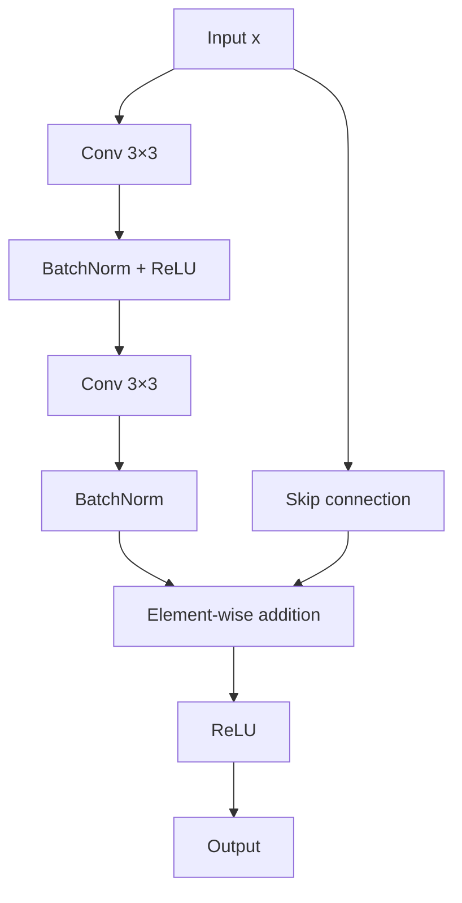

# 4.1.2 – ResNet-18: modellkutatás és kísérlettervezés

## 1. Feladat adatai

| Megnevezés | Érték |
|---|---|
| Felelős | Anna |
| Feature branch | `feature/04-01-02-resnet18-research` |
| Modell | ResNet-18 |
| Modellcsalád | Deep Learning – Residual Convolutional Neural Network |

## 2. Feladat célja

A ResNet-18 elméleti hátterének, reziduális blokkjainak és skip connectionjeinek bemutatása, valamint az architektúra adaptálásának megtervezése a Fashion-MNIST egycsatornás, 28×28 pixeles képeihez és tíz kimeneti osztályához.

A modell a projekt legmélyebb konvolúciós architektúrájaként lehetőséget biztosít annak vizsgálatára, hogy a nagyobb modellkapacitás és a reziduális tanulás milyen prediktív teljesítményt eredményez a hagyományos ML-modellekhez, az MLP-hez és a Simple CNN-hez viszonyítva.

A dokumentáció előzetes kísérleti tervet tartalmaz, nem tényleges mérési eredményeket.

## 3. Elméleti háttér és modellválasztás

### 3.1. Residual Networks

A Residual Network (ResNet) architektúrát He és szerzőtársai (2016) vezették be a mély neurális hálózatok optimalizálási nehézségeinek mérséklésére [1].

A hagyományos mély hálózatokban a rétegek számának növelése egy bizonyos ponton túl magasabb tanítási hibát eredményezhet. Ezt a jelenséget degradation problemnek nevezzük, amely nem azonos a túlilleszkedéssel.

A ResNet a közvetlen leképezés megtanulása helyett reziduális leképezést alkalmaz. Amennyiben a kívánt leképezés H(x), a reziduális blokk az alábbi függvényt tanulja:

$$
F(x)=H(x)-x
$$

Az eredeti leképezés így visszaállítható:

$$
H(x)=F(x)+x
$$

A bemenet közvetlen hozzáadása a konvolúciós rétegek kimenetéhez megkönnyítheti az információ és a gradiensek továbbítását, ezáltal támogatva a mélyebb architektúrák optimalizálását [1].

### 3.2. Reziduális blokkok és skip connection

A ResNet-18 úgynevezett BasicBlock egységekből épül fel, amelyek két 3×3-as konvolúciós réteget, Batch Normalization rétegeket és ReLU aktivációkat tartalmaznak.

A blokk két útvonalon dolgozza fel a bemenetet:

- Main path: Conv2d → BatchNorm → ReLU → Conv2d → BatchNorm.
- Shortcut path: identity mapping vagy dimenzióillesztést végző projekció.
- A két útvonal kimenete elemenként összeadódik, majd ReLU aktiváció következik.



Azonos bemeneti és kimeneti dimenziók esetén a shortcut identity mappinget alkalmaz, amely nem igényel további tanulható paramétereket.

Eltérő dimenziók esetén a Torchvision implementációjában 1×1-es konvolúció és Batch Normalization biztosítja a megfelelő csatornaszámot és térbeli méretet [1, 5].

A Batch Normalization a köztes aktivációk normalizálásával támogathatja a hálózat optimalizálását [2]. Nem azonos a bemeneti képeken alkalmazható opcionális standardizálással.

### 3.3. Modellválasztás indoklása

A ResNet-18 négy reziduális szakaszból áll, szakaszonként két BasicBlock egységgel. Az architektúra 17 fő konvolúciós réteget és egy teljesen összekapcsolt osztályozóréteget tartalmaz, innen ered a 18 rétegű megnevezés.

A Simple CNN-hez képest több konvolúciós réteggel és nagyobb modellkapacitással rendelkezik, így összetettebb képi reprezentációk megtanulására lehet alkalmas.

Nocentini és szerzőtársai (2022) Fashion-MNIST-en végzett kísérleteikben 94,04%-os osztályozási pontosságot értek el egy 15 konvolúciós réteget tartalmazó hálózattal. Eredményeik támogatják a mélyebb konvolúciós architektúrák vizsgálatát, azonban nem igazolják a ResNet-18 szükségszerű fölényét [3].

| Előnyök | Korlátok |
|---|---|
| Hierarchikus képi jellemzőkinyerés | Jelentős számítási erőforrásigény |
| Reziduális kapcsolatok támogatják az optimalizációt | Nagyobb memória- és tárhelyigény |
| Összetett vizuális összefüggések modellezése | Túlilleszkedés lehetősége |
| A képek térbeli struktúrájának hasznosítása | A kis felbontású bemenet korlátozhatja a mélység előnyét |
| End-to-end jellemzőtanulás | Összetettebb tanítási folyamat |

A ResNet-18-tól a vizsgált modellek között magas, potenciálisan a legjobb osztályozási teljesítményt várjuk. A Simple CNN-hez viszonyított javulás mértéke azonban előzetesen nem ismert.

## 4. Bemeneti adatok és előfeltételek

- Közös adatbetöltés: `load_dataset()`.
- Közös stratifikált adatfelosztás: `load_split()`, `data/splits.npz`, seed 42.
- Training: 50 000; validation: 10 000; official test: 10 000 kép.
- Közös DL preprocessing: `build_dataloaders()`.
- Baseline bemenet: `[B, 1, 28, 28]` alakú, [0, 1] tartományú float32 tenzor.
- Célváltozó: `[B]` alakú, int64 típusú osztálycímkék, 0–9 közötti értékekkel.
- Modellkimenet: `[B, 10]` alakú logitmátrix.
- Opcionális preprocessing: standardizálás és training-only augmentáció.
- Könyvtárak: PyTorch 2.7.1, Torchvision 0.22.1, NumPy, Matplotlib, scikit-learn.

A standardizáláshoz szükséges átlagot és szórást kizárólag a végleges training halmazon határozzuk meg. Az így illesztett transzformációt a training, validation és test adatokra is alkalmazzuk.

Az augmentáció kizárólag a training halmazt érinti.

A hálózatot véletlenszerűen inicializált súlyokkal, előtanított modell alkalmazása nélkül tanítjuk.

## 5. Megvalósítási és architekturális terv

### 5.1. ResNet-18 adaptálása

A Torchvision eredeti ResNet-18 implementációja háromcsatornás ImageNet-képekhez és 1000 kimeneti osztályhoz készült [5].

A Fashion-MNIST kisebb képmérete miatt az alábbi módosításokat tervezzük:

| Réteg / tulajdonság | Eredeti ResNet-18 | Adaptált ResNet-18 |
|---|---|---|
| Input channels | 3 | 1 |
| Conv1 kernel size | 7×7 | 3×3 |
| Conv1 stride | 2 | 1 |
| Conv1 padding | 3 | 1 |
| Kezdeti max pooling | 3×3, stride=2 | Identity |
| BasicBlock konfiguráció | [2, 2, 2, 2] | Változatlan |
| Csatornaszámok | 64, 128, 256, 512 | Változatlan |
| Global Average Pooling | 1×1 | Változatlan |
| Fully connected output | 1000 | 10 |
| Pretrained weights | Opcionális | None |

A kisebb kernelméret és a kezdeti max pooling elhagyása megakadályozza a térbeli felbontás túl gyors csökkentését. Hasonló megfontolás jelenik meg az eredeti ResNet-publikáció kis felbontású CIFAR-10 képekre tervezett architektúráinál is [1].

A saját módosításaink a ResNet-18 reziduális szakaszait és csatornaszámait változatlanul hagyják.

### 5.2. Tervezett architektúra

| Réteg | Konfiguráció | Kimeneti alak (batch nélkül) |
|---|---|---|
| Input | Grayscale image | 1 × 28 × 28 |
| Conv1 | Conv2d(1, 64, 3, stride=1, padding=1) | 64 × 28 × 28 |
| BatchNorm + ReLU | 64 csatorna | 64 × 28 × 28 |
| MaxPool | Identity | 64 × 28 × 28 |
| Layer 1 | 2 BasicBlock, 64 csatorna | 64 × 28 × 28 |
| Layer 2 | 2 BasicBlock, 128 csatorna, első blokk stride=2 | 128 × 14 × 14 |
| Layer 3 | 2 BasicBlock, 256 csatorna, első blokk stride=2 | 256 × 7 × 7 |
| Layer 4 | 2 BasicBlock, 512 csatorna, első blokk stride=2 | 512 × 4 × 4 |
| Average Pooling | AdaptiveAvgPool2d((1, 1)) | 512 × 1 × 1 |
| Flatten | – | 512 |
| Fully Connected | Linear(512, 10) | 10 |

A Global Average Pooling csatornánként egyetlen értékre aggregálja az utolsó reziduális szakasz jellemzőtérképeit.

Az adaptált architektúra tervezett tanítható paraméterszáma 11 172 810. A pontos értéket a tényleges implementáció során ellenőrizzük.

### 5.3. Tervezett implementáció

A modell a Torchvision ResNet-18 implementációjának újrafelhasználásával készül:

```python
from torch import nn
from torchvision.models import resnet18

model = resnet18(weights=None)
model.conv1 = nn.Conv2d(
    1, 64, kernel_size=3, stride=1,
    padding=1, bias=False
)
model.maxpool = nn.Identity()
model.fc = nn.Linear(model.fc.in_features, 10)
```

A létrehozott konvolúciós és osztályozórétegek inicializálását a tényleges implementáció során egységesen rögzítjük.

Tervezett fájlok:

- `src/models/dl/resnet18.py`
- `notebooks/resnet18.ipynb`
- `results/experiments/resnet18.csv`
- `results/figures/resnet18/`
- A modelltréninghez tartozó külön feature-dokumentáció.

A mentett modellek és szükséges preprocessing konfigurációk az `artifacts/` mappában kapnak helyet.

## 6. Baseline konfiguráció

A tanítási konfigurációt a Simple CNN baseline modelljével összehangolva határozzuk meg, hogy a modellarchitektúrák összehasonlítása kontrolláltabb körülmények között történjen.

| Paraméter | Érték | Indoklás |
|---|---|---|
| Optimizer | Adam | Adaptív gradiensalapú optimalizálás [4] |
| Learning rate | 0.001 | Közös DL kiinduló érték |
| Loss | CrossEntropyLoss | Többosztályos osztályozás |
| Batch size | 64 | Közös DL baseline |
| Epoch | 10 | Egységes kezdeti tanítási keret |
| Dropout | 0 | Külön regularizációs kísérlet |
| Weight decay | 0 | Közös baseline konfiguráció |
| Learning rate scheduler | None | Külön optimalizálási kísérlet |
| Standardizálás | False | Közös DL baseline |
| Augmentáció | None | Közös DL baseline |
| Pretrained weights | None | Tanítás előtanítás nélkül |
| Random seed | 42 | Inicializálás és mintakeverés |
| Device | CUDA, ha elérhető; egyébként CPU | Futtatási környezet függvényében |

### Veszteségfüggvény és predikció

A többosztályos osztályozás során CrossEntropyLoss veszteségfüggvényt alkalmazunk:

$$
L=-\frac{1}{N}\sum_{i=1}^{N}\log P(y_i|x_i)
$$

A PyTorch CrossEntropyLoss közvetlenül a modell nyers logitjait és az egész számként reprezentált célváltozókat várja, ezért a modell kimenetére a veszteségszámítás előtt nem alkalmazunk külön softmax függvényt [6].

A prediktált osztály a legmagasabb logithoz tartozó kategória. Valószínűségi kimenet előállításához opcionálisan softmax alkalmazható.

## 7. Kísérleti terv

### 7.1. Tervezett kísérletek

| Run ID | Eltérés a baseline-tól | Hipotézis |
|---|---|---|
| RN-00 | Nincs | Mély reziduális referenciamodell |
| RN-01 | Dropout=0.3 az osztályozófej előtt | Mérsékelhető a túlillesztés |
| RN-02 | Learning rate=0.0003 | Stabilabb, esetleg lassabb konvergencia |
| RN-03 | standardize=True | Javulhat az optimalizálás és a konvergencia |
| RN-04 | RandomAffine(degrees=8, translate=(0.05, 0.05)) | Javulhat a modell általánosítási képessége |
| RN-05 | Weight decay=0.0001 | Mérsékelhető a túlillesztés a súlyok regularizációjával |
| RN-06 | CosineAnnealingLR, T_max=10 | A fokozatos learning rate csökkentés javíthatja a konvergenciát |
| RN-07 | Legígéretesebb beállítások kombinációja | További teljesítményjavulás lehetséges |
| RN-08 (opcionális) | 20 epoch a kiválasztott konfigurációval | Vizsgálható a hosszabb tanítás hatása |
| RN-09 (opcionális) | Eredeti stem, egy bemeneti csatornával | Vizsgálható a kezdeti méretcsökkentés hatása |

Az egyedi kísérletek során egy tényezőt változtatunk, a többi baseline paraméter változatlan marad. A kombinált konfigurációba a validation eredmények alapján választjuk ki a legígéretesebb beállításokat.

### 7.2. Regularizációs kísérletek

A dropout kísérletben a Global Average Pooling és Flatten műveleteket követően, a teljesen összekapcsolt osztályozóréteg előtt alkalmazunk dropoutot.

A weight decay kísérletben az Adam optimalizáló regularizációs paraméterét módosítjuk. A két technika hatását külön vizsgáljuk, majd szükség esetén kombináljuk.

### 7.3. Preprocessing kísérletek

A standardizálás és augmentáció a közös DL preprocessing pipeline segítségével történik.

| Konfiguráció | Standardize | Augmentation |
|---|---|---|
| Baseline | False | None |
| RN-03 | True | None |
| RN-04 | False | RandomAffine |

Az augmentáció paramétereit a Simple CNN kísérleti tervével egyezően határozzuk meg, így összehasonlítható az azonos transzformáció hatása a két konvolúciós architektúrára.

A transzformáció mérsékelt forgatást és eltolást alkalmaz, a képméret változtatása nélkül.

### 7.4. Learning rate és tanítási idő

A kisebb learning rate stabilabb optimalizációt eredményezhet, azonban azonos epochszám mellett lassabb tanuláshoz is vezethet.

A CosineAnnealingLR kísérletben a learning rate 0.001-ről fokozatosan csökken a tíz epoch során. A scheduler hatását a baseline állandó learning rate konfigurációjához viszonyítjuk.

A hosszabb tanítás opcionális kísérlet, amelyet az első futtatások learning curve-jei és futásideje alapján véglegesítünk.

### 7.5. Architektúra-adaptálási kísérlet

Opcionálisan összehasonlítjuk az adaptált kezdőréteget az eredeti ResNet stemhez közelebb álló konfigurációval: 7×7-es, stride=2 konvolúció és 3×3-as, stride=2 max pooling.

Mindkét esetben egy bemeneti csatornát, tíz kimeneti osztályt és azonos reziduális szakaszokat alkalmazunk.

A vizsgálat célja annak meghatározása, hogy a kezdeti térbeli felbontás megőrzése milyen pontossági és számítási költségbeli különbséget eredményez.

## 8. Értékelési protokoll és vizualizációk

- Minden futtatás azonos mentett train/validation splitet használ.
- Minden futtatás során a legjobb validation accuracy értéket elérő epoch modellállapotát mentjük el.
- Rögzítendő: training és validation accuracy, macro F1-score, loss, preprocessing time, training time, inference time, modellméret, paraméterszám, konfiguráció, seed és futtatási környezet.
- Epochonként rögzítjük a training és validation loss, accuracy és macro F1-score értékeket.
- Modellválasztás: legmagasabb validation accuracy, egyezéskor macro F1-score, majd a közös csapatprotokoll szerinti döntési szempont.
- Validáció és inferencia során `model.eval()` és gradiensszámítás nélküli futtatás szükséges.
- GPU-alapú futásidőmérésnél az időmérés előtt és után CUDA-szinkronizálást alkalmazunk.
- Az inferenciaidőt a közösen meghatározott mérési protokoll alapján rögzítjük.
- A mentett modell méretét egységes szerializálási módszerrel, bájtban mérjük.
- A teszthalmazon kizárólag a véglegesített baseline és optimalizált konfiguráció értékelése történik, tesztalapú tuning nélkül.

### Tervezett vizualizációk

- Baseline és optimalizált modell confusion matrixa.
- Training és validation accuracy, loss és macro F1 learning curve-ök.
- Baseline és optimalizált konfigurációk metrikáinak összehasonlítása.
- Learning rate kísérletek összehasonlítása.
- Standardizálás és augmentáció hatásának vizualizálása.
- Tanítási idő, inferenciaidő és modellméret összehasonlítása.
- Feature map vizualizáció a különböző reziduális szakaszokból.
- Opcionálisan hibásan osztályozott validációs minták.

A feature map vizualizáció célja a hálózat különböző mélységeiben megtanult képi reprezentációk szemléltetése, illetve összevetése a Simple CNN aktivációival.

Az ábrák a TERV.xlsx fájlban meghatározott közös színpaletta alapján készülnek.

## 9. Korlátok és következő lépések

A ResNet-18 jelentősen nagyobb modellkapacitással rendelkezik, mint a Simple CNN. Emiatt hosszabb tanítási időre és nagyobb memóriaigényre számítunk, miközben a Fashion-MNIST kis felbontása miatt a pontosságbeli előny nem garantált.

A baseline futtatását követően a rendelkezésre álló számítási kapacitás, futásidő és learning curve-ök alapján pontosítjuk az optimalizálási kísérletek körét.

A Simple CNN-nel közös kísérleteket prioritásként kezeljük, hogy a két architektúra összehasonlíthatósága megmaradjon.

A tényleges implementáció, mérési eredmények és kutatási hipotézisek értékelése külön dokumentációban készül el.

## 10. Felhasznált források

1. He, K., Zhang, X., Ren, S., & Sun, J. (2016). Deep Residual Learning for Image Recognition. IEEE CVPR, 770–778. https://doi.org/10.1109/CVPR.2016.90
2. Ioffe, S., & Szegedy, C. (2015). Batch Normalization: Accelerating Deep Network Training by Reducing Internal Covariate Shift - Abstract. ICML, 448–456. https://proceedings.mlr.press/v37/ioffe15.html
3. Nocentini, O., Kim, J., Bashir, M. Z., & Cavallo, F. (2022). Image Classification Using Multiple Convolutional Neural Networks on the Fashion-MNIST Dataset. Sensors, 22(23), 9544. https://doi.org/10.3390/s22239544
4. Kingma, D. P., & Ba, J. (2015). Adam: A Method for Stochastic Optimization - Abstract. ICLR. https://arxiv.org/abs/1412.6980
5. Torchvision 0.22 – ResNet-18. https://docs.pytorch.org/vision/0.22/models/generated/torchvision.models.resnet18.html
6. PyTorch 2.7 – CrossEntropyLoss. https://docs.pytorch.org/docs/2.7/generated/torch.nn.CrossEntropyLoss.html
